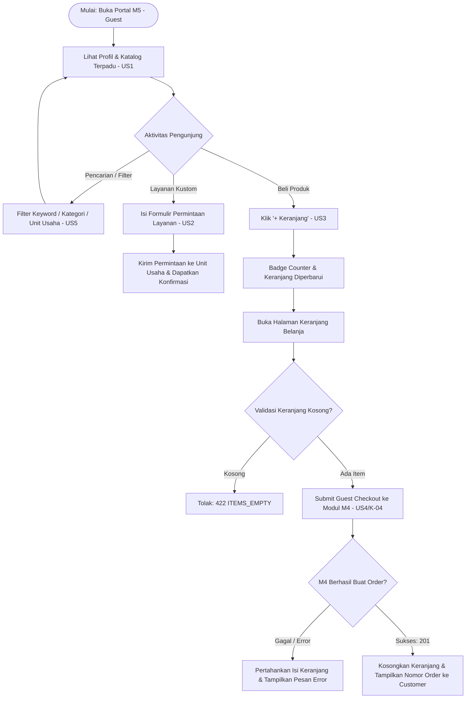
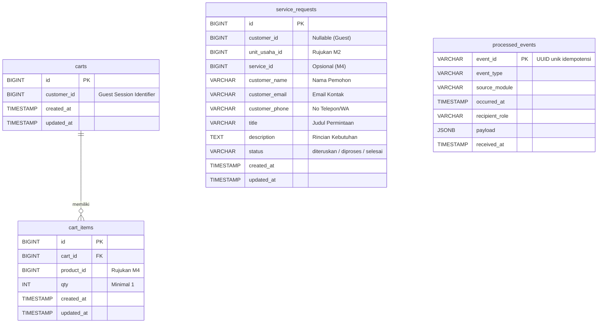

# PRD Modul 5 – Portal Customer & Katalog Terpadu
**Produk:** Araya Business Hub Platform  
**Kelas:** A (Fondasi) · **Kelompok:** A5 · **Versi:** 1.2 (Pembaruan: Model Full Guest Checkout & Desain Tanpa Login)  
**Status:** Disetujui & Siap untuk Penilaian Dosen  

---

## 1. Ringkasan Eksekutif
Modul 5 (M5) adalah pintu depan Customer pada ekosistem platform Araya Business Hub. Melalui M5, Customer dapat:
1. Melihat profil dan katalog seluruh unit usaha Badan Pengelola Usaha (BPU) dalam satu halaman terpadu.
2. Mencari dan menyaring produk/jasa berdasarkan kata kunci, kategori, dan unit usaha.
3. Mengisi dan mengirim formulir permintaan layanan langsung ke unit usaha tujuan.
4. Mengumpulkan produk ke dalam keranjang belanja (*cart*).
5. Melakukan *checkout* dari keranjang menjadi Order resmi melalui integrasi kontrak Modul M4.

**Model Akses Publik (Guest Checkout):** Sesuai kesepakatan integrasi dengan **Modul M1**, portal customer M5 beroperasi penuh menggunakan model **Guest Checkout** (tanpa kewajiban login/registrasi akun customer ke M1). M1 difokuskan untuk otentikasi internal staf/administrator. Dengan demikian, customer dapat langsung menjelajah, memesan produk, dan mengajukan layanan secara cepat tanpa friksi proses login.

M5 mengonsumsi data dari modul-modul lain: data unit usaha dari **M2**, serta katalog produk dan kontrak Order dari **M4**.

---

## 2. Latar Belakang dan Masalah
1. **Etalase Terfragmentasi:** Unit-unit usaha BPU saat ini tersebar dan belum memiliki etalase bersama, menyulitkan customer menemukan produk atau jasa yang dibutuhkan dalam satu tempat.
2. **Ketiadaan Jalur Komunikasi Formal:** Customer yang memerlukan layanan khusus/kustom belum memiliki saluran resmi untuk mengajukan permintaan penawaran langsung ke unit usaha.
3. **Pemesanan Manual Tidak Efisien:** Tanpa adanya sistem keranjang belanja dan checkout terpadu, pembelian beberapa produk dari berbagai kategori masih dicatat manual dan rentan kesalahan.
4. **Friksi Registrasi:** Mengharuskan pengunjung mendaftar akun hanya untuk sekadar membeli produk atau bertanya layanan seringkali menurunkan minat transaksi. Model *guest checkout* menyelesaikan masalah ini.

---

## 3. Tujuan dan Batasan

### 3.1 Tujuan
* Menyediakan katalog publik satu halaman yang menampilkan profil seluruh unit usaha aktif beserta produk/jasanya.
* Memfasilitasi pencarian cepat dengan pencocokan kata kunci, kategori, dan unit usaha dengan waktu respons cepat.
* Menyediakan formulir digital permohonan layanan yang tervalidasi dan langsung diteruskan ke unit usaha terkait.
* Memungkinkan customer mengelola keranjang belanja dan melakukan checkout langsung (*guest checkout*) terintegrasi ke Modul M4.

### 3.2 Non-Tujuan (Di Luar Cakupan M5)
* Pengelolaan master data unit usaha dan aktivasi/deaktivasi unit (Tanggung jawab **M2**).
* Pendaftaran akun, login, dan manajemen hak akses pengguna (Tanggung jawab **M1**; sistem M1 mengelola staf/admin internal).
* Input master produk, pembuatan quotation, invoice, pembayaran payment gateway, serta perubahan status pemrosesan pesanan (Tanggung jawab **M4**).
* Verifikasi dan registrasi Partner BPU (Tanggung jawab **M3**).
* Manajemen dashboard analitik operasional (Tanggung jawab **M2**).

---

## 4. Persona dan Pengguna

| Persona | Deskripsi | Kebutuhan Utama di Modul M5 |
| :--- | :--- | :--- |
| **Customer (Guest / Pengunjung)** | Pengunjung umum / pembeli produk dan jasa unit usaha BPU. | Menemukan produk/jasa dengan cepat, bertanya kustom via form layanan, serta berbelanja dan checkout langsung tanpa login. |
| **Unit Usaha (Penerima)** | Pengelola unit usaha BPU yang menerima permohonan layanan. | Menerima data permohonan yang valid, lengkap, dan terarah beserta kontak customer (nama, email, no HP) yang valid. |

---

## 5. Ruang Lingkup: 5 User Story

| ID | User Story | Prioritas |
| :--- | :--- | :---: |
| **M5-US1** | Sebagai Customer, saya ingin melihat profil dan katalog seluruh unit usaha BPU dalam satu halaman, supaya mudah menemukan produk/jasa yang dicari. | **Must** |
| **M5-US2** | Sebagai Customer, saya ingin mengisi formulir permintaan layanan, supaya dapat menghubungi unit usaha secara langsung. | **Should** |
| **M5-US3** | Sebagai Customer, saya ingin menambahkan produk ke keranjang saat menjelajahi katalog, supaya bisa mengumpulkan beberapa produk sebelum checkout. | **Must** |
| **M5-US4** | Sebagai Customer, saya ingin checkout dari keranjang menjadi Order, supaya produk yang saya pilih diproses jadi transaksi (memakai kontrak Order dari M4). | **Must** |
| **M5-US5** | Sebagai Customer, saya ingin mencari dan menyaring katalog berdasarkan kata kunci, kategori, atau unit usaha, supaya cepat menemukan produk/jasa yang dicari. | **Must** |

---

## 6. Kebutuhan Fungsional & Acceptance Criteria (AC)

### 6.1 M5-US1 – Profil dan Katalog Unit Usaha dalam Satu Halaman
* **Kebutuhan Fungsional:**
  * **FR-1.1:** Halaman katalog memuat seluruh unit usaha berstatus aktif dari Modul M2 (`GET /api/m2/v1/business-units`).
  * **FR-1.2:** Menampilkan nama, kategori, profil singkat unit usaha, dan daftar produk/jasa aktif miliknya.
  * **FR-1.3:** Setiap item produk menampilkan nama, deskripsi singkat, harga, dan tombol `+ Keranjang`.
  * **FR-1.4:** Unit usaha yang nonaktif di M2 tidak boleh ditampilkan.
  * **FR-1.5:** Halaman katalog bersifat **publik** (dapat diakses oleh siapa saja tanpa akun).
* **Acceptance Criteria (AC):**
  1. *Given customer buka halaman, When load, Then seluruh unit usaha tampil dalam 1 halaman.*
  2. *Given tidak ada unit usaha aktif, When load, Then tampil pesan kosong yang wajar (HTTP 200 dengan data `[]`).*
  3. *(Tambahan) Given sebuah unit usaha dinonaktifkan di M2, When customer memuat ulang katalog, Then unit tersebut beserta produknya tidak lagi ditampilkan.*

---

### 6.2 M5-US2 – Formulir Permintaan Layanan ke Unit Usaha
* **Kebutuhan Fungsional:**
  * **FR-2.1:** Formulir memuat field: `unit_usaha_id`, `customer_name`, `customer_email`, `customer_phone`, `title`, dan `description`.
  * **FR-2.2:** Unit usaha tujuan dipilih secara valid dari daftar unit usaha aktif.
  * **FR-2.3:** Validasi server: Seluruh field wajib diisi, format email valid, nomor telepon minimal 8 digit angka. Jika tidak valid, kembalikan HTTP `422` beserta rincian field yang salah.
  * **FR-2.4:** Customer mengisi identitas langsung di form tanpa perlu login terlebih dahulu.
  * **FR-2.5:** Permintaan yang berhasil disimpan diberi status awal `"diteruskan"` ke unit usaha terkait di database.
* **Acceptance Criteria (AC):**
  1. *Given form diisi lengkap, When submit, Then permintaan diteruskan ke unit usaha.*
  2. *Given form tidak lengkap, When submit, Then sistem tolak & tampilkan validasi (HTTP 422 dengan pesan error per field).*
  3. *(Tambahan) Given form valid dikirim, When permintaan tersimpan, Then customer melihat pesan konfirmasi dan permintaan tercatat di database dengan timestamp serta ID unit usaha tujuan.*

---

### 6.3 M5-US3 – Tambah Produk ke Keranjang Belanja
* **Kebutuhan Fungsional:**
  * **FR-3.1:** Terdapat tombol `+ Keranjang` pada tiap kartu produk aktif.
  * **FR-3.2:** Klik pertama pada produk membuat baris baru di keranjang dengan `qty = 1` dan badge keranjang bertambah 1.
  * **FR-3.3:** Klik pada produk yang sudah ada di keranjang hanya menambah kuantitas (`qty += 1`), bukan membuat baris duplikat.
  * **FR-3.4:** Customer dapat mengubah kuantitas (`PATCH /api/m5/v1/cart/items/:id`) dan menghapus item (`DELETE /api/m5/v1/cart/items/:id`).
  * **FR-3.5:** Keranjang menghitung otomatis subtotal per item, total keseluruhan tagihan, dan total item (*badge counter*).
* **Acceptance Criteria (AC):**
  1. *Given produk tampil di katalog, When klik "+ Keranjang", Then item tersimpan & badge bertambah 1.*
  2. *Given produk sudah ada di keranjang, When klik "+ Keranjang" lagi, Then qty bertambah (bukan entri baru).*
  3. *(Tambahan) Given item ada di keranjang, When customer menghapus item atau mengubah qty, Then rincian keranjang, badge counter, dan total tagihan langsung terhitung ulang.*

---

### 6.4 M5-US4 – Checkout Keranjang Menjadi Order (Kontrak K-04)
* **Kebutuhan Fungsional:**
  * **FR-4.1:** Menampilkan ringkasan daftar belanjaan, kuantitas, harga, dan total pembayaran sebelum checkout.
  * **FR-4.2:** Checkout beroperasi menggunakan model **Guest Checkout** (tanpa kewajiban login/token JWT M1).
  * **FR-4.3:** Saat submit checkout, M5 memanggil kontrak resmi **K-04** ke Modul M4: `POST /api/m4/v1/orders`.
  * **FR-4.4:** Jika keranjang kosong, sistem wajib menolak dengan kode galat HTTP `422` (`code: "ITEMS_EMPTY"`).
  * **FR-4.5:** Ketika M4 mengembalikan sukses (HTTP 201), seluruh item keranjang di M5 otomatis dikosongkan dan respons order dikembalikan ke customer.
  * **FR-4.6:** Jika panggilan ke M4 gagal, keranjang tetap utuh dan pesan error diteruskan ke customer.
* **Acceptance Criteria (AC):**
  1. *Given keranjang berisi item, When checkout, Then Order terbentuk lewat kontrak M4.*
  2. *Given keranjang kosong, When coba checkout, Then sistem cegah & tampilkan pesan (HTTP 422 ITEMS_EMPTY).*
  3. *(Tambahan) Given pembentukan Order gagal di sisi M4, When customer checkout, Then keranjang tetap utuh dan customer melihat pesan error resmi dari platform.*

---

### 6.5 M5-US5 – Cari dan Saring Katalog
* **Kebutuhan Fungsional:**
  * **FR-5.1:** Input pencarian `q` mencocokkan nama, kategori, dan deskripsi produk secara *case-insensitive*.
  * **FR-5.2:** Filter `unit_usaha_id` dan `category` dapat dikombinasikan dengan pencarian teks bebas.
  * **FR-5.3:** Dilengkapi dengan pagination terstandar (`page`, `per_page`, `total`, `total_pages`).
  * **FR-5.4:** Jika pencarian tidak membuahkan hasil, kembalikan HTTP `200` dengan array kosong `[]` (bukan error).
* **Acceptance Criteria (AC):**
  1. *Given katalog tampil, When customer cari kata kunci atau pilih kategori/unit usaha, Then hanya produk/jasa yang sesuai tampil.*
  2. *Given tidak ada hasil, When pencarian dijalankan, Then tampil pesan "tidak ditemukan" (HTTP 200 data kosong, bukan error).*
  3. *(Tambahan) Given customer memakai kata kunci dan filter unit usaha sekaligus, When query dijalankan, Then hasil memenuhi kedua kriteria tersebut secara presisi.*

---

## 7. Alur Pengguna Utama (Guest User Flow)


---

## 8. Ketergantungan Antar-Modul (Berdasarkan Panduan API Bersama v1.0)

M5 mengadopsi kontrak integrasi resmi kelas Araya Business Hub:

| Modul Penyedia | ID Kontrak | Endpoint & Method | Deskripsi Kebutuhan di M5 |
| :--- | :---: | :--- | :--- |
| **M1** *(Auth)* | - | - | **Tidak ada dependensi login.** Disepakati bersama M1 bahwa M5 berjalan penuh sebagai Guest Portal (M1 fokus mengelola akun admin/staf). |
| **M2** *(Business Units)* | **K-02** | `GET /api/m2/v1/business-units` | Mengambil seluruh unit usaha aktif untuk ditampilkan di beranda katalog dan dropdown form layanan. |
| **M4** *(Products)* | **K-05** | `GET /api/m4/v1/products` | Mengambil data produk/jasa aktif untuk ditampilkan di katalog M5. |
| **M4** *(Order)* | **K-04** | `POST /api/m4/v1/orders` | Mengirim data checkout keranjang belanja M5 menjadi pesanan resmi di M4. |
| **Antarmodul** | **Bab 5** | `POST /api/m5/v1/events` | Endpoint penerima webhook event antarmodul ber-header `X-Service-Key` dengan jaminan idempotency. |

### Detail Spesifikasi Kontrak K-04 (Guest Checkout M5 $\rightarrow$ M4):
* **Request:**
  ```http
  POST /api/m4/v1/orders
  Content-Type: application/json

  {
    "customer_id": 1,
    "source": "website",
    "items": [
      { "product_id": 31, "qty": 2 },
      { "product_id": 40, "qty": 1 }
    ]
  }
  ```
* **Response Sukses (HTTP 201 Created):**
  ```json
  {
    "success": true,
    "data": {
      "id": 125,
      "order_no": "ORD-20261028-0007",
      "status": "baru",
      "total_amount": 185000
    }
  }
  ```
* **Kode Galat Kontrak K-04:**
  * `422 ITEMS_EMPTY`: Daftar item pesanan kosong.
  * `409 PRODUCT_INACTIVE`: Ada produk dalam keranjang yang sudah tidak aktif.

---

## 9. Model Data (Database Modul M5)

Sesuai aturan platform (*snake_case*, bahasa Inggris, dan terhubung ke PostgreSQL Supabase):



---

## 10. Kebutuhan Non-Fungsional (NFR)
1. **Format Amplop Standar:** Seluruh respons sukses berformat `{ success: true, data, meta }` dan galat berformat `{ success: false, error: { code, message, fields } }`.
2. **Kinerja & Responsivitas:** Halaman katalog dan pencarian merespons $\le 2$ detik dengan paginasi bawaan 20 item per halaman.
3. **Keandalan Serverless:** Arsitektur backend mendukung *zero-crash cold starts* di Vercel dengan koneksi basis data *lazy connection* ke PostgreSQL Supabase.
4. **Idempotensi Webhook:** Webhook penerima event (`/events`) mengabaikan `event_id` yang sudah pernah dicatat dan merespons HTTP 200 seketika untuk mencegah *timeout*.
5. **Dokumentasi Terbuka:** Spesifikasi OpenAPI 3.0.3 terintegrasi dan dapat diakses langsung via Swagger UI di URL `/api/m5/v1/docs`.

---

## 11. Kasus Tepi dan Aturan Bisnis (Edge Cases)
1. **Produk Dinonaktifkan Saat Sudah Ada di Keranjang:** Sistem memvalidasi keaktifan produk via M4 sebelum checkout. Jika tidak aktif, lemparkan galat `409 PRODUCT_INACTIVE`.
2. **Pencarian Karakter Kosong atau Simbol:** Query `q` kosong mengembalikan seluruh katalog aktif secara normal (bukan error).
3. **Spam Klik Tombol `+ Keranjang`:** Penambahan kuantitas bersifat atomik di database dengan constraint unik `(cart_id, product_id)`.
4. **Koneksi M4 Terputus Saat Checkout:** Item keranjang tidak boleh terhapus sebelum respons HTTP 201 diterima dari M4.
5. **Event Masuk Berulang Kali:** Jika event dengan `event_id` yang sama masuk kembali, sistem mencatat log *duplicate*, tidak memproses logika bisnis ulang, dan tetap membalas HTTP 200.

---

## 12. Metrik Keberhasilan Demo & Pengujian
* **100% Lulus AC:** Seluruh 10 AC resmi dosen dan 5 AC usulan kelompok lulus uji integrasi dan Postman.
* **Alur End-to-End Mulus (Guest Flow):** Customer dapat menelusuri katalog $\rightarrow$ tambah item $\rightarrow$ checkout langsung $\rightarrow$ Order tercatat di M4.
* **Penanganan Kasus Kosong:** Halaman katalog dan hasil pencarian kosong menampilkan UI ramah pengguna dengan status HTTP 200.
* **Live Deployment:** Backend terverifikasi aktif di Vercel dan database tersinkronisasi di cloud Supabase.

---

## 13. Rencana Sprint
* **Sprint 1 (Fondasi & Fitur Mandiri):**
  * Setup arsitektur NestJS, Prisma, koneksi cloud Supabase, dan deployment Vercel.
  * Implementasi M5-US1 (Katalog Terpadu), M5-US2 (Formulir Permintaan Layanan), dan M5-US3 (Keranjang Belanja).
  * Penyusunan kontrak Swagger OpenAPI di `/api/m5/v1/docs`.
* **Sprint 2 (Integrasi & Pemantapan):**
  * Integrasi penuh Kontrak K-04 (Guest Checkout Order ke M4).
  * Implementasi M5-US5 (Pencarian & Multi-Filter Katalog).
  * Pengujian integrasi antarmodul di server bersama kelas dan uji idempotensi event.

---

## 14. Keputusan Desain & Penyelarasan Integrasi
1. **Full Guest Mode (Tanpa Login):** Seluruh endpoint M5 (katalog, pengajuan layanan, keranjang, hingga checkout order) beroperasi secara publik / guest tanpa mewajibkan customer membuat akun atau login ke Modul M1. Ini menyederhanakan arsitektur, menghilangkan bottleneck ketergantungan pada modul otentikasi, dan mempercepat alur transaksi customer.
2. **Persistensi Keranjang Guest:** Keranjang disimpan di database sisi server terikat pada identitas sesi guest.
3. **Batas Tanggung Jawab Order:** M5 berhenti setelah Order terbentuk di M4. Pengelolaan invoice, pembayaran, dan status delivery sepenuhnya dikelola oleh M4.
4. **Mock Resilien:** M5 dilengkapi fallback data internal yang realistis agar tim frontend dapat melakukan *development* dan *testing* meskipun server M2 atau M4 kelompok lain belum aktif.

---

## 15. Dokumen Referensi
1. **Panduan Integrasi · Berlaku untuk Semua Modul (Panduan API Bersama v1.0 - 28 Okt 2026).**
2. **Studi Kasus Capstone Project Kelas A (Fondasi) - Modul M1 s/d M14.**
3. **Spesifikasi OpenAPI Resmi M5:** `docs/openapi.yaml`.
